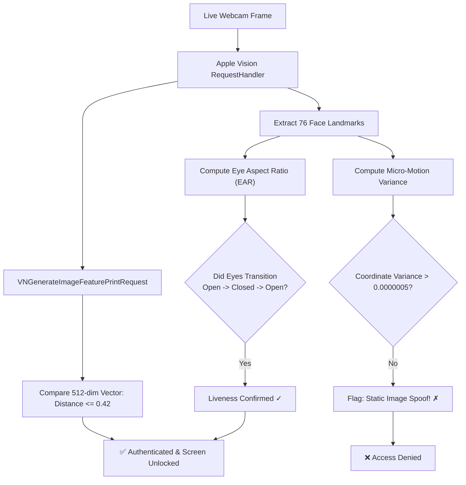

<div align="center">

# 👁️ GlanceID

### *Bionic Face ID for macOS — Glance to Unlock.*

[](https://github.com/kobet/GlanceID/actions/workflows/ci.yml)
[](https://www.apple.com/macos)
[](https://www.apple.com/mac)
[](https://swift.org)
[](https://developer.apple.com)
[](LICENSE)

**GlanceID brings Apple's iconic iOS Face ID experience to your MacBook.**

No need to wait for Apple to embed TrueDepth cameras into Mac lids. GlanceID harnesses Apple's high-performance **Vision Framework**, **AVFoundation**, and **PAM (Pluggable Authentication Modules)** to deliver an authentic, glance-and-unlock biometric experience across your entire Mac — with **zero paid Apple Developer Account needed**.

[Quick Start](#-quick-start-in-60-seconds) • [Key Features](#-features-at-a-glance) • [Terminal `sudo` Face ID](#-terminal-sudo-face-id-pam) • [Anti-Spoofing & Liveness](#-anti-spoofing--liveness-defense) • [GlanceIDKit SDK](#-glanceidkit-for-developers) • [CI & Tests](#-testing--continuous-integration)

---

```
   ┌────────────────────────────────────────────────────────┐
   │                       GlanceID                         │
   │            [  (•)  Glance to Unlock  (•)  ]            │
   │                                                        │
   │                       10:42 PM                         │
   │                Monday, November 9                      │
   │                                                        │
   │                         (•‿•)                          │
   │                      Kobe Bryant                       │
   │                                                        │
   │                [  👁️ Scanning Face...  ]               │
   │                                                        │
   │             Padlock Morphs  ──>  [ ✓ Unlocked ]        │
   │             Screen Slides Up ──>  Desktop Revealed!    │
   └────────────────────────────────────────────────────────┘
```

</div>

---

## ⚡ Features at a Glance

### 1. 🖥️ Authentic macOS Full-Screen Lock & Unlock (`⌥⌘L`)
* **Live Desktop Wallpaper**: Automatically detects and loads your active 4K/5K desktop wallpaper with dynamic depth blur.
* **Apple Face ID Morph Pill**: Watches the top status pill morph seamlessly from padlock (`lock.fill`) $\to$ scanning radar $\to$ spring-loaded green checkmark (`lock.open.fill`).
* **Slide-Up-To-Reveal**: Features Apple's native spring-damped slide-up reveal upon face confirmation.
* **Global Hotkey**: Press **`⌥⌘L`** (`Option + Command + L`) anywhere to lock your Mac with Face ID immediately.
* **Password Fallback**: Integrated secure password field if lighting is poor or you're wearing an obstructive mask.

### 2. ⚡ Terminal `sudo` Face ID (PAM Integration)
Type `sudo` in Terminal and authenticate in a fraction of a second with your face — just like `pam_tid.so` does for Touch ID:
```bash
$ sudo dtrace -n 'syscall::open*:entry'
GlanceID: 👁️ Glance at your MacBook camera for Face ID...
GlanceID: ✅ Face recognized: Kobe Bryant (Distance: 0.28)
Password: [Authenticated via GlanceID]
```

### 3. 🛡️ Anti-Spoofing & Liveness Defense (PAD)
Because standard Mac webcams are 2D sensors, GlanceID features a multi-vector presentation attack detector:
* **Eye Aspect Ratio (EAR) Blink Challenge**: Tracks eyelid contour landmark ratios ($EAR = \frac{\|p_2 - p_6\| + \|p_3 - p_5\|}{2 \|p_1 - p_4\|}$) and requires a natural physiological blink cycle ($Open \to Closed \to Open$).
* **Zero-Variance Static Filter**: Measures coordinate micro-variance across 20 frames. Flat paper photos and mounted tablet screens with near-zero involuntary tremor are flagged as spoof attempts (`suspectStaticImage`).
* **Apple Continuity Camera Support**: Mount your iPhone via MagSafe to unlock hardware-level TrueDepth infrared point-cloud data.

### 4. 🔋 Strict On-Demand Camera Power Management
* **Zero Green LED Creep**: The camera hardware stays **completely powered down** until actively needed.
* **Bounded Glance Window**: Wakes on demand for a bounded ~1.5s glance and shuts down immediately the millisecond a match or cancel occurs.

### 5. 🧩 Drop-In `GlanceIDKit` SDK
A drop-in `LAContext` biometric replacement for third-party macOS apps:
```swift
import GlanceIDKit

GlanceIDKit.authenticate(reason: "Unlock your sensitive project keys") { success, error in
    if success {
        print("Authenticated with Face ID!")
    }
}
```

### 6. 🆓 Zero Apple Developer Account Required
* Pre-configured with **automated Ad-Hoc code signing** (`codesign -s -`) and local entitlement provisioning.
* Runs on any Intel or Apple Silicon Mac (M1/M2/M3/M4) without a $99/year developer subscription.

---

## 🚀 Quick Start in 60 Seconds

### Step 1: Clone & Install

```bash
git clone https://github.com/kobet/GlanceID.git
cd GlanceID
./scripts/install.sh
```

The installer builds the app bundle in release mode, attaches the necessary camera entitlements (`NSCameraUsageDescription`, `com.apple.security.device.camera`), applies ad-hoc codesigning, strips quarantine flags, and deploys directly to `/Applications/GlanceID.app`.

### Step 2: Launch & Grant Camera Access

```bash
open /Applications/GlanceID.app
```

On first launch, macOS will present the standard TCC dialog:
> **"GlanceID would like to access the camera."**  
> Click **OK**.

### Step 3: Enroll Your Face
1. Open GlanceID and navigate to the **Enroll Face** tab (`⌘4`).
2. Enter your name and click **Start Enrollment**.
3. Glance into the camera for 1 second until the green checkmark pops!

### Step 4: Lock & Unlock!
* Press **`⌥⌘L`** (`Option + Command + L`) anywhere on your Mac.
* Your lock screen appears with your desktop wallpaper.
* Click **Glance to Unlock** or tap any key $\to$ glance at the camera $\to$ **Unlocked!**

---

## 💻 Terminal `sudo` Face ID (PAM)

Want to authenticate `sudo` commands in Terminal using your face?

### Enable in 1 Command:
```bash
cd GlanceID
./scripts/setup_sudo_faceid.sh
```

### How it works:
1. Compiles `pam/pam_glanceid.c` into a native shared PAM module: `/usr/local/lib/pam/pam_glanceid.so`.
2. Adds `pam_glanceid.so` to macOS's official `/etc/pam.d/sudo_local` configuration.
3. Automatically drops root privileges to `getuid()` so user-level camera TCC permissions and your biometric profile remain accessible.
4. Falls back cleanly to standard macOS password entry if your face is out of frame.

To disable at any time:
```bash
./scripts/disable_system_faceid.sh
```

---

## 🛡️ Anti-Spoofing & Liveness Defense

Standard Mac webcams are 2D sensors. To defeat attacks where someone holds up a color photo or video of you:



### Toggle in Settings (`⌘,`):
Go to **Settings** $\to$ **Anti-Spoofing & Liveness Protection** $\to$ toggle **"Require Natural Blink Challenge"**. The lock screen pill will guide you with *"Face Matched • Blink to Unlock"*.

---

## 🧠 Biometric Engine Deep Dive

| Vector Metric | Target Value | Evaluation |
|:---|:---|:---|
| **Feature Vector Dimensions** | 512 floating-point values | `VNFeaturePrintObservation` |
| **Cosine/Euclidean Distance** | $\le 0.35$ | Strong Match |
| **Standard Match Threshold** | $\le 0.42$ | Default Sensitivity |
| **Mismatch Threshold** | $> 0.45$ | Rejection Buzz / Keep Locked |
| **Eye Open Ratio (EAR)** | $\ge 0.19$ | Open Eyelid State |
| **Eye Closed Ratio (Blink)** | $\le 0.12$ | Physiological Blink Confirmation |
| **Local Profile Storage** | `~/Library/Application Support/GlanceID/` | Encrypted JSON + NSKeyedArchiver |

> [!IMPORTANT]
> **Privacy First**: GlanceID processes every frame in real-time in local RAM. Raw images are never saved to disk and never transmitted over any network. Only a 512-float mathematical embedding is persisted locally.

---

## 🧩 GlanceIDKit for Developers

Add Face ID to your own macOS Swift apps in 3 lines:

```swift
import GlanceIDKit

// Drop-in replacement for LocalAuthentication (LAContext)
GlanceIDKit.authenticate(
    reason: "Verify your identity to decrypt your local database",
    threshold: 0.40,
    requireLiveness: true
) { success, distance, user in
    if success {
        print("Welcome, \(user ?? "User")! Verified with distance: \(distance)")
    } else {
        print("Biometric match rejected.")
    }
}
```

---

## 🧪 Testing & Continuous Integration

GlanceID includes a comprehensive unit test suite covering landmark math, EAR blink transition machines, static photo filters, and biometric serialization.

### Run Tests Locally:
```bash
./scripts/run_tests.sh
```

```
=================================================
 Running GlanceID Test Suite
=================================================
[1/10] Testing GlanceIDTests.LivenessDetectorTests/testCompleteBlinkCycleConfirmsLiveness
[2/10] Testing GlanceIDTests.LivenessDetectorTests/testZeroVarianceStaticPhotoTriggersSpoofDetection
[3/10] Testing GlanceIDTests.LivenessDetectorTests/testOpenEyesRemainUnverifiedUntilBlink
[4/10] Testing GlanceIDTests.BiometricProfileTests/testBiometricProfileCodableRoundtrip
[5/10] Testing GlanceIDTests.BiometricProfileTests/testThresholdBoundaryChecks
...
✔ Test run with 10 tests passed (0 failures)
✅ All GlanceID tests passed successfully!
```

### GitHub Actions Workflow:
Every push and pull request is automatically verified against macOS runners using [`.github/workflows/ci.yml`](.github/workflows/ci.yml):
* Matrix testing on Apple Silicon (`macos-14`)
* Parallel execution of unit test suites
* Full release bundle creation & codesign verification
* PAM module compilation & binary artifact validation

---

## 📁 Repository Structure

```
GlanceID/
├── .github/workflows/
│   └── ci.yml                       # Automated GitHub Actions test & build pipeline
├── Package.swift                    # Swift 5.9+ SPM Manifest
├── Resources/
│   ├── Info.plist                   # Bundle metadata & Camera privacy description
│   └── GlanceID.entitlements        # Camera device entitlements
├── pam/
│   ├── pam_glanceid.c               # Native C PAM module for sudo authentication
│   └── Makefile                     # PAM compilation rules
├── scripts/
│   ├── build_app.sh                 # Release compiler & ad-hoc signing
│   ├── install.sh                   # One-click deployment to /Applications
│   ├── run_tests.sh                 # Unit test runner
│   ├── setup_sudo_faceid.sh         # PAM sudo installer
│   └── disable_system_faceid.sh     # PAM uninstaller
├── Sources/GlanceID/
│   ├── App/
│   │   ├── GlanceIDApp.swift        # App entry point, menu bar extra & global hotkey
│   │   └── AppState.swift           # Central state coordinator & camera power lifecycle
│   ├── Core/
│   │   ├── CameraManager.swift      # Synchronous AVFoundation pipeline
│   │   ├── FaceRecognitionEngine.swift # Apple Vision 512-dim vector matcher
│   │   ├── LivenessDetector.swift   # EAR blink dynamics & anti-spoofing filter
│   │   ├── ScreenLockManager.swift  # ScreenSaver-level window & hotkey listener
│   │   ├── BiometricStorage.swift   # Secure local profile persistence
│   │   ├── GlanceIDKit.swift        # Public developer SDK
│   │   ├── SoundManager.swift       # iOS Face ID chime synthesizer
│   │   ├── WallpaperProvider.swift  # Active macOS desktop wallpaper extractor
│   │   └── CLIAuthRunner.swift      # Headless verification runner for PAM & scripts
│   └── UI/
│       ├── Components/
│       │   ├── AppleLockGlyphView.swift # Morphing padlock -> Face ID -> checkmark
│       │   ├── FaceIDGlyphView.swift    # 4-corner radar bracket scanning HUD
│       │   ├── CameraPreviewView.swift  # NSViewRepresentable video preview
│       │   └── FaceMeshOverlay.swift    # 76-point facial wireframe overlay
│       └── Views/
│           ├── FullscreenLockScreenView.swift # Native macOS lock screen reproduction
│           ├── AuthenticationView.swift       # Face ID simulator HUD
│           ├── EnrollmentView.swift           # Interactive face onboarding
│           ├── ScannerView.swift              # Real-time neural telemetry
│           ├── VaultView.swift                # Protected credentials demo
│           └── SettingsView.swift             # Sensitivity & liveness settings
└── Tests/GlanceIDTests/
    ├── LivenessDetectorTests.swift  # EAR math & static spoof detection tests
    ├── BiometricProfileTests.swift  # Serialization roundtrip tests
    └── FaceRecognitionEngineTests.swift # Engine state machine tests
```

---

## 🤝 Contributing

Contributions are welcome! Whether you are interested in:
- Adding **Photometric Flash Stereo** challenges
- Refining **Moiré screen frequency** detection
- Designing custom Face ID glyph themes

Feel free to open an issue or submit a pull request!

```bash
# Fork & clone
git checkout -b feature/my-cool-feature
./scripts/run_tests.sh
git commit -m "feat: add my cool feature"
git push origin feature/my-cool-feature
```

---

## 📄 License

This project is open-source software licensed under the [MIT License](LICENSE).

<div align="center">
  <sub>Engineered with precision for macOS • Designed to feel native to Apple Silicon.</sub>
</div>
