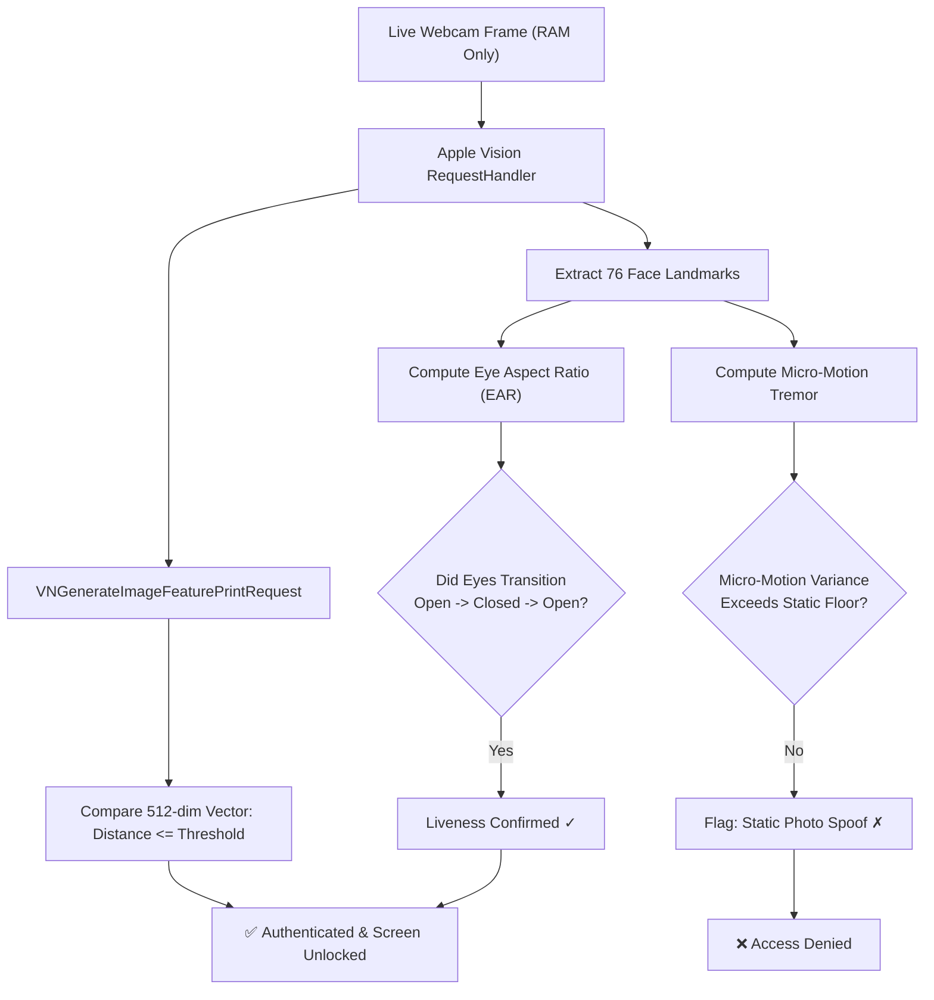

<div align="center">

  

  # GlanceID

  ### *Bionic Face ID for macOS — Glance to Unlock.*

  [](https://github.com/kobenguyent/GlanceID/actions/workflows/ci.yml)
  [](https://www.apple.com/macos)
  [](https://www.apple.com/mac)
  [](https://swift.org)
  [](https://developer.apple.com)
  [](LICENSE)

  <p align="center">
    <b>GlanceID brings Apple's iconic iOS Face ID experience to your MacBook lid.</b><br />
    Powered by Apple Vision, AVFoundation, and native PAM — with zero paid developer account, zero cloud dependencies, and 100% on-device neural processing.
  </p>

  <p align="center">
    <a href="#-quick-start">Quick Start</a> •
    <a href="#-features-at-a-glance">Key Features</a> •
    <a href="#-terminal-sudo-face-id-pam">Terminal sudo</a> •
    <a href="#-anti-spoofing--liveness-defense">Anti-Spoofing</a> •
    <a href="#-glanceidkit-for-developers">GlanceIDKit SDK</a> •
    <a href="#-testing--verification">Tests & CI</a>
  </p>

</div>

---

<div align="center">

```
 ┌───────────────────────────────────────────────────────────────┐
 │                      (•) FaceTime HD                          │
 │                                                               │
 │                          10:42 PM                             │
 │                    Monday, November 11                        │
 │                                                               │
 │                      ┌───         ───┐                        │
 │                      │   •       •   │  <-- Live Gaze Dots    │
 │                      │       ─       │                        │
 │                      └───         ───┘                        │
 │                                                               │
 │                   [ 👁️ Face Matched: Kobe ]                   │
 │                                                               │
 │        Padlock Morphs ──> Spring Checkmark Pop (0.35s)        │
 │        Screen Slides Up ──> Desktop Wallpaper Revealed        │
 └───────────────────────────────────────────────────────────────┘
```

</div>

---

## ⚡ Features at a Glance

### 1. 🖥️ Central Holographic Face ID HUD (`⌥⌘L`)
* **Vision Pro Vector HUD**: Seamless center-screen biometric reticle (`CentralFaceIDScanView`) featuring dynamic corner brackets, scanning laser sweep, and real-time eye gaze focus dots.
* **5 Dynamic Reactive States**: Seamlessly transitions between `.searching` (ambient cyan pulse), `.tracking` (targeted bracket framing), `.liveness` (gold blink prompt), `.success` (spring checkmark pop & shockwave ripple), and `.failure` (amber/red rejection).
* **Live Desktop Wallpaper**: Automatically detects and renders your active 4K/5K desktop wallpaper with depth-blur backdrop.
* **Global Hotkey (`⌥⌘L`)**: Press **`Option + Command + L`** anywhere on your Mac to lock with Face ID immediately.
* **Motion & Accessibility**: Fully conforms to `@Environment(\.accessibilityReduceMotion)` for low-stimulus environments.

### 2. ⚡ Terminal `sudo` Face ID (PAM Integration)
Type `sudo` in Terminal and authenticate in under a second with your face — just like Touch ID (`pam_tid.so`):
```bash
$ sudo dtrace -n 'syscall::open*:entry'
GlanceID: 👁️ Glance at your MacBook camera for Face ID...
GlanceID: ✅ Face recognized: Kobe Bryant (Distance: 0.28)
Password: [Authenticated via GlanceID]
```

### 3. 🛡️ Multi-Vector Anti-Spoofing & Liveness Defense (PAD)
Standard Mac webcams are 2D sensors. GlanceID defeats photo and screen playback attacks with a dual-stage presentation attack detector:
* **Eye Aspect Ratio (EAR) Blink Challenge**: Tracks eyelid contour landmark ratios ($EAR = \frac{\|p_2 - p_6\| + \|p_3 - p_5\|}{2 \|p_1 - p_4\|}$) and requires a physiological blink cycle ($Open \to Closed \to Open$).
* **Zero-Variance Static Filter**: Measures coordinate micro-variance across 20 frames. Flat photos and tablet screens with near-zero micro-tremors are rejected (`suspectStaticImage`).
* **Continuity Camera Support**: Mount your iPhone via MagSafe to unlock hardware-level TrueDepth infrared point-cloud depth data.

### 4. 🧠 Real-Time Neural Scanner & Diagnostics
* **76-Point Facial Mesh**: Interactive wireframe overlay tracking eye contours, eyebrows, nasal ridge, lips, and outer jawline.
* **Head Pose & Telemetry**: Real-time pitch, yaw, and roll metrics, face bounding box dimensions, and lighting assessment.

### 5. 🔒 Zero-Trust Privacy & Hardware Lifecycle
* **Zero Green LED Creep**: The camera hardware stays **completely powered down** until actively needed.
* **Bounded Glance Window**: Wakes on demand for a bounded ~1.5s glance and shuts down immediately the millisecond a match or cancel occurs.
* **Zero Image Storage**: Frames exist only as volatile `CVPixelBuffer`s in local RAM. Raw images are never saved to disk and never transmitted over any network.
* **Zero Network Permissions**: The macOS app sandbox contains no network client entitlement (`com.apple.security.network.client`), preventing outbound socket connections.

### 6. 🧩 Drop-In `GlanceIDKit` SDK
A drop-in `LAContext` biometric replacement for third-party macOS apps:
```swift
import GlanceIDKit

GlanceIDKit.authenticate(
    reason: "Unlock sensitive developer secrets",
    threshold: 0.40,
    requireLiveness: true
) { success, distance, user in
    if success {
        print("Authenticated with Face ID! Distance: \(distance)")
    }
}
```

### 7. 🆓 Zero Apple Developer Account Required
* Automated **Ad-Hoc code signing** (`codesign -s -`) and local entitlement provisioning.
* Runs on any Intel or Apple Silicon Mac (M1/M2/M3/M4) without a $99/year developer membership.

---

## 🚀 Quick Start

### Option A: Build & Install from Source (Recommended)

```bash
git clone https://github.com/kobenguyent/GlanceID.git
cd GlanceID
./scripts/install.sh
```

The installer builds the app bundle in release mode, attaches camera entitlements, applies ad-hoc codesigning, strips quarantine flags, and installs directly to `/Applications/GlanceID.app`.

### Option B: Download Pre-built Release (DMG)

1. Download **`GlanceID.dmg`** from [Releases](https://github.com/kobenguyent/GlanceID/releases).
2. Open `GlanceID.dmg` and drag `GlanceID.app` into `/Applications`.
3. If macOS displays an ad-hoc Gatekeeper warning on first launch, strip the download flag in Terminal:
   ```bash
   xattr -cr /Applications/GlanceID.app
   ```
   *(Or right-click `GlanceID.app` in Finder $\to$ choose **Open** $\to$ click **Open**)*.

---

### Step-by-Step Walkthrough

```
[ Step 1: Launch ]          [ Step 2: Enroll ]          [ Step 3: Lock & Glance ]
 open /Applications/          Open "Enroll Face" (⌘4)      Press ⌥⌘L anywhere
 GlanceID.app                 Glance for 1 second          Glance at camera ──> Unlocked!
```

1. **Launch**: Run `open /Applications/GlanceID.app`. When macOS displays the standard permission prompt *"GlanceID would like to access the camera"*, click **OK**.
2. **Enroll Face**: Navigate to the **Enroll Face** tab (`⌘4`). Enter your name, click **Start Enrollment**, and look into the camera for 1 second until the checkmark confirms your profile.
3. **Lock & Unlock**: Press **`⌥⌘L`** (`Option + Command + L`) anywhere on macOS. The lock screen appears with your wallpaper. Tap any key or glance into the camera to unlock!

---

## 💻 Terminal `sudo` Face ID (PAM)

Authenticate command-line administrative access with your face:

### Enable in 1 Command:
```bash
./scripts/setup_sudo_faceid.sh
```

### How it works:
1. Compiles `pam/pam_glanceid.c` into a native PAM module: `/usr/local/lib/pam/pam_glanceid.so`.
2. Configures `/etc/pam.d/sudo_local` (Apple's official non-destructive PAM extension mechanism, preserved across macOS system updates).
3. Drops root privileges to user session (`getuid()`) so camera TCC permissions and local biometric profiles remain secure.
4. Falls back cleanly to standard macOS password entry if your face is out of frame.

To disable at any time:
```bash
./scripts/disable_system_faceid.sh
```

---

## 🛡️ Anti-Spoofing & Liveness Defense



### Toggle in Settings (`⌘,`):
Open **Settings** $\to$ **Anti-Spoofing & Liveness Protection** $\to$ toggle **"Require Natural Blink Challenge"**. The central HUD prompts with *"Face Matched • Blink to Unlock"*.

---

## 🧠 Biometric Engine Deep Dive

| Specification | Value | Technical Description |
|:---|:---|:---|
| **Feature Vector Dimensions** | 512 floating-point values | `VNFeaturePrintObservation` (Revision 2) |
| **Strict Match Threshold** | $\le 0.28$ | Low false-acceptance rate for high-security environments |
| **Standard Match Threshold** | $\le 0.42$ | Default balanced sensitivity |
| **Lenient Match Threshold** | $\le 0.52$ | Tolerant of wide lighting variations or glasses |
| **Eye Open Ratio (EAR)** | $\ge 0.19$ | Open eyelid state |
| **Eye Closed Ratio (Blink)** | $\le 0.12$ | Physiological blink trigger |
| **Stabilization Dwell** | $\approx 350\text{ ms}$ | Multi-frame pacing window ensuring visible feedback |
| **Local Profile Storage** | `~/Library/Application Support/GlanceID/` | Encrypted JSON + `NSKeyedArchiver` |
| **Outbound Network** | None (Disabled) | Zero network entitlement in macOS Sandbox |

---

## 🧪 Testing & Verification

GlanceID includes an automated 33-unit-test suite validating landmark calculations, EAR blink transition state machines, zero-variance photo filters, HUD animations, and biometric profile serialization.

### Run Tests:
```bash
./scripts/run_tests.sh
```

```
=================================================
 Running GlanceID Test Suite
=================================================
✔ Test run with 33 tests in 8 suites passed (0 failures)
✅ All GlanceID tests passed successfully!
```

### Test Coverage Highlights:
* `CentralFaceIDScanViewTests`: State resolution, HUD captions, and accessibility motion overrides.
* `ReticleBracketShapeTests`: Vector path generation, corner radius clamping, and animatable data.
* `FullscreenLockScreenViewTests`: Overlay layout jitter resistance and slide-up unlock transitions.
* `FaceRecognitionTelemetryTests`: Real-time landmark streaming and ~350ms dwell stabilization.
* `LivenessDetectorTests`: Complete blink cycle machines and static zero-variance spoof rejection.
* `BiometricProfileTests`: Cryptographic serialization and threshold boundary safety.

---

## 📁 Repository Structure

```
GlanceID/
├── .github/workflows/
│   └── ci.yml                          # Automated GitHub Actions test & build pipeline
├── Package.swift                       # Swift 5.9+ SPM Manifest (macOS 13+)
├── Resources/
│   ├── AppIcon.png                     # High-resolution application brand icon
│   ├── AppIcon.icns                    # macOS native multi-resolution icon bundle
│   ├── Info.plist                      # Bundle metadata & Camera privacy description
│   └── GlanceID.entitlements           # Sandboxed camera entitlements
├── pam/
│   ├── pam_glanceid.c                  # Native C PAM module for sudo authentication
│   └── Makefile                        # PAM compilation rules
├── scripts/
│   ├── build_app.sh                    # Release compiler & ad-hoc signing
│   ├── install.sh                      # One-click deployment to /Applications
│   ├── run_tests.sh                    # Parallel unit test runner
│   ├── setup_sudo_faceid.sh            # PAM sudo installer
│   └── disable_system_faceid.sh        # PAM uninstaller
├── Sources/GlanceID/
│   ├── App/
│   │   ├── GlanceIDApp.swift           # App entry point, menu bar extra & global hotkey
│   │   └── AppState.swift              # Central state coordinator & camera power lifecycle
│   ├── Core/
│   │   ├── CameraManager.swift         # Synchronous AVFoundation pipeline
│   │   ├── FaceRecognitionEngine.swift    # Apple Vision 512-dim vector matcher & dwell pacing
│   │   ├── LivenessDetector.swift      # EAR blink dynamics & anti-spoofing filter
│   │   ├── ScreenLockManager.swift     # ScreenSaver-level window & hotkey listener
│   │   ├── BiometricStorage.swift      # Secure local profile persistence
│   │   ├── GlanceIDKit.swift           # Public developer SDK
│   │   ├── SoundManager.swift          # iOS Face ID chime synthesizer
│   │   ├── WallpaperProvider.swift     # Active macOS desktop wallpaper extractor
│   │   └── CLIAuthRunner.swift         # Headless verification runner for PAM & scripts
│   └── UI/
│       ├── Components/
│       │   ├── CentralFaceIDScanView.swift # Vision Pro holographic vector HUD & animations
│       │   ├── ReticleBracketShape.swift   # Animatable vector corner brackets
│       │   ├── AppleLockGlyphView.swift    # Morphing padlock -> Face ID -> checkmark
│       │   ├── FaceIDGlyphView.swift       # 4-corner radar bracket scanning HUD
│       │   ├── CameraPreviewView.swift     # NSViewRepresentable video preview
│       │   └── FaceMeshOverlay.swift       # 76-point facial wireframe overlay
│       └── Views/
│           ├── FullscreenLockScreenView.swift # Native macOS lock screen reproduction
│           ├── LockScreenHubView.swift        # Lock screen controller & monitor routing
│           ├── AuthenticationView.swift       # Face ID simulator HUD
│           ├── EnrollmentView.swift           # Interactive face onboarding
│           ├── ScannerView.swift              # Real-time neural telemetry & mesh
│           ├── VaultView.swift                # Protected credentials demo
│           └── SettingsView.swift             # Sensitivity & liveness settings
└── Tests/GlanceIDTests/
    ├── AppStateTests.swift             # Camera & app state propagation tests
    ├── CentralFaceIDScanViewTests.swift# HUD states, captions & motion tests
    ├── ReticleBracketShapeTests.swift  # Vector geometry & boundary tests
    ├── FullscreenLockScreenViewTests.swift # Lock screen layout & presentation tests
    ├── FaceRecognitionTelemetryTests.swift# Landmark streaming & dwell pacing tests
    ├── FaceRecognitionEngineTests.swift   # Engine state machine tests
    ├── LivenessDetectorTests.swift     # EAR math & static spoof detection tests
    └── BiometricProfileTests.swift     # Serialization roundtrip tests
```

---

## 🤝 Contributing

Contributions are welcome! Whether you are interested in:
- Adding **Photometric Flash Stereo** challenges
- Refining **Moiré screen frequency** detection
- Designing custom Face ID glyph themes

Feel free to open an issue or submit a pull request!

```bash
# Fork & clone
git checkout -b feature/my-cool-feature
./scripts/run_tests.sh
git commit -m "feat: add my cool feature"
git push origin feature/my-cool-feature
```

---

## 📄 License

This project is open-source software licensed under the [MIT License](LICENSE).

<div align="center">
  <sub>Engineered with precision for macOS • Designed to feel native to Apple Silicon.</sub>
</div>
